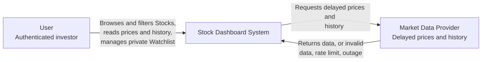
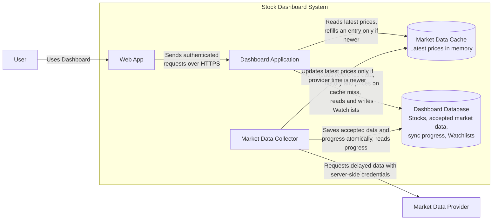
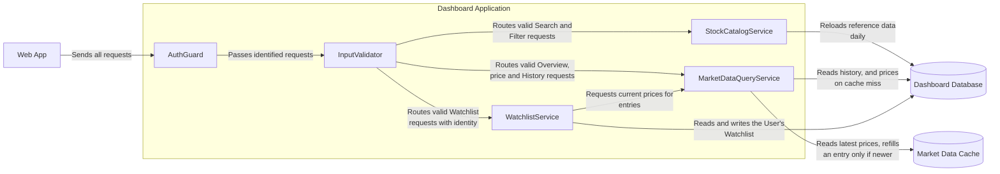
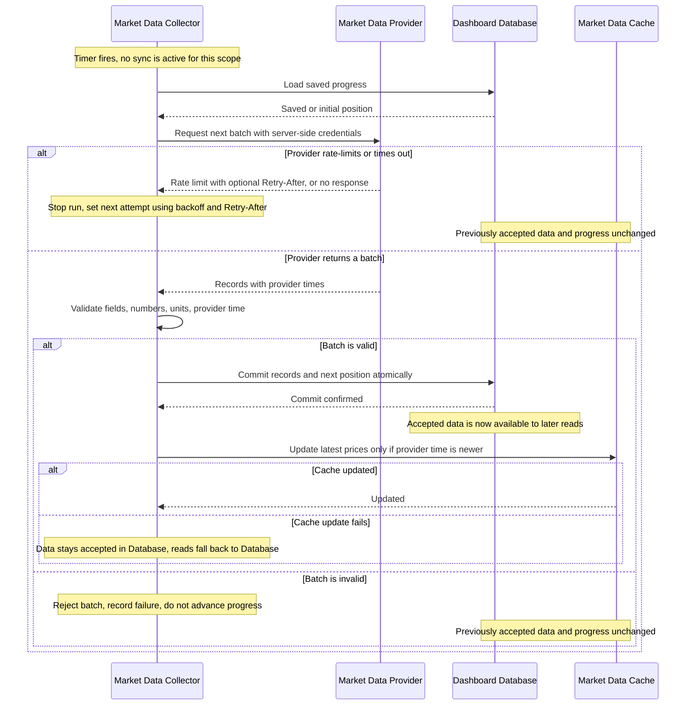
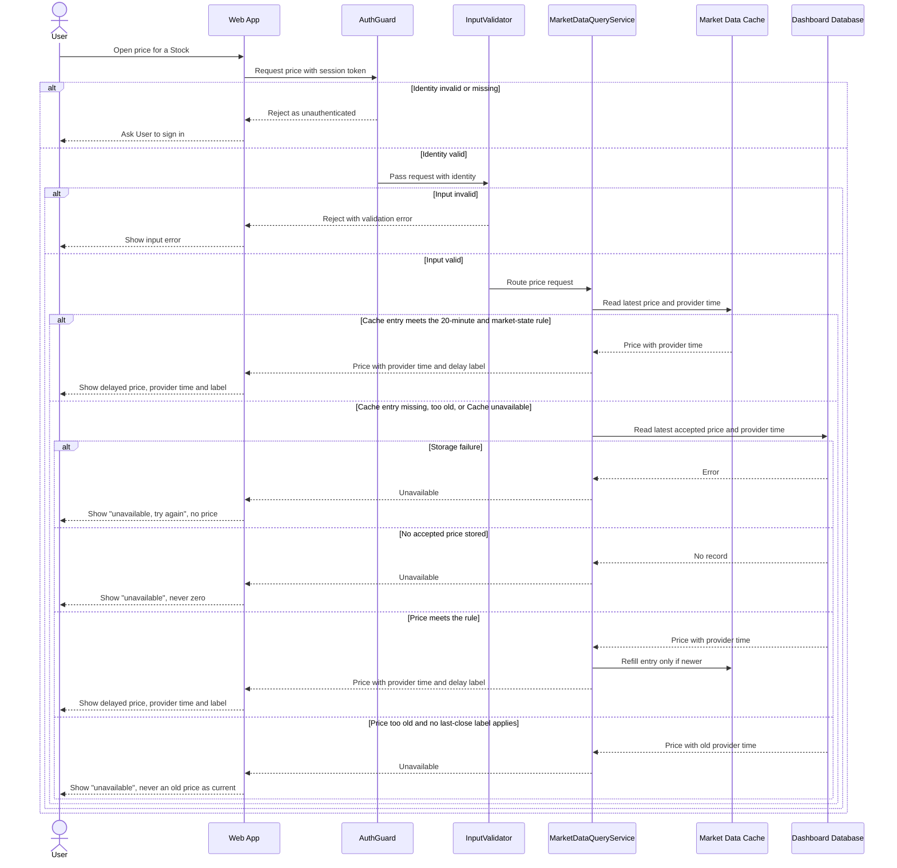
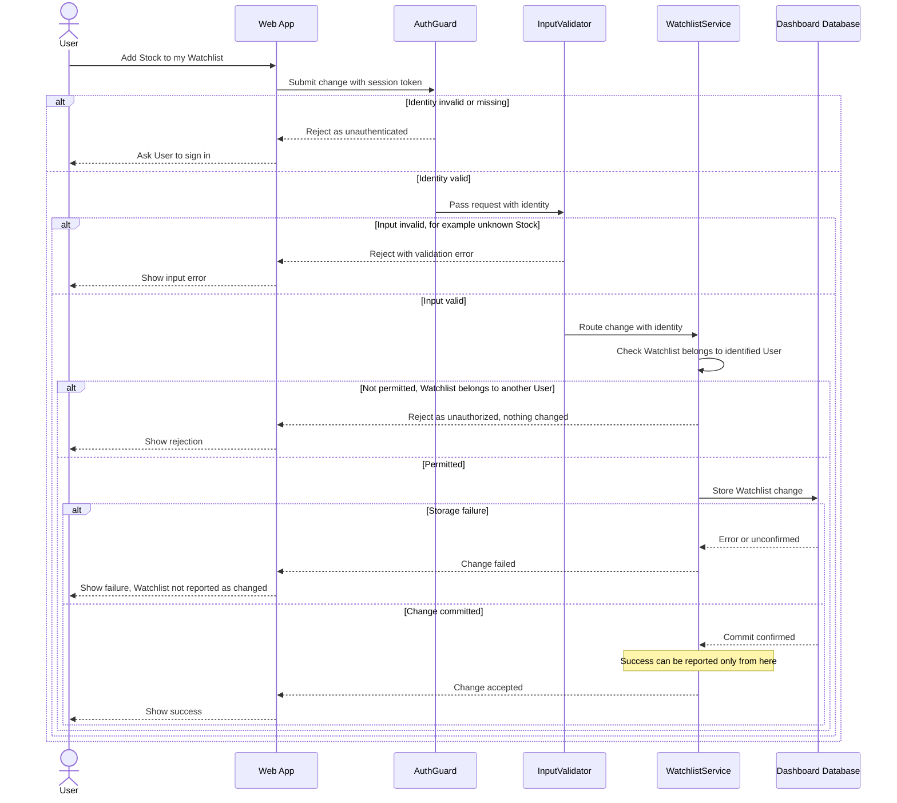

# Lab 3: Draw the Dashboard Boundary

## Starting assumptions

| Item | Value from Lab 2 |
| ---- | ---------------- |
| Scales | 300, 3,000 and 30,000 concurrent Users |
| Market-open load targets | 103, 1,030 and 10,296 read RPS across six reads: Overview, Filter, Stock price, History, Watchlist, Search |
| Largest steady reads at 30,000 Users | Stock price 6,000 RPS (75.8% of traffic), Filter 750, Overview 700 (1,600 at open), Watchlist 300 (840 at open) |
| Latency | Every read p95 <= 2,000 ms. Stock price p50 <= 300 ms and p95 <= 1,000 ms. At 5,000 ms the Web App stops waiting and shows "unavailable, try again" |
| Availability | 99.9% in market hours (8.19 min downtime per 30 days), 99% outside |
| Price freshness rule | A price is accepted if its provider time is at most 20 minutes old (15 min provider delay + 5 min sync). Outside market hours, the last close is shown labelled "market closed". From open until open + 20 min, the last close is shown labelled "previous close". Otherwise the read returns "unavailable". A price is never shown as zero |
| Monotonic reads | A later read of a Stock never shows an earlier provider time than a read before it |
| Watchlist | Read-your-writes for the same User in any session. A User can never read or change another User's Watchlist |
| Sync schedule | Latest prices every 60 s in market hours, intraday points every 5 min, daily bars once after close, reference data once per day |
| Data size | 5,172 active Stocks, 5,690 reference records. Latest prices about 0.74 MiB, reference data about 1.10 MiB, all market data about 1.05 GiB initially |
| Not in Lab 2 | Provider request quota (assumed enough for one latest-price scan per 60 s, to be verified). Identity: the User holds a session token, and the Dashboard Application verifies it on every request |

---

## 1. System Context

The provider is a separately controlled system. Its failures are shown at the boundary, and its internals are not.

---

## 2. Container

Five parts are the smallest set that meets the Lab 2 targets:

| Container | Responsibility |
| --------- | -------------- |
| Web App | Shows the Dashboard to the User in a browser |
| Dashboard Application | Checks identity, input and permissions, and serves the six reads and Watchlist changes. Runs as several identical stateless instances |
| Market Data Collector | Fetches, validates and saves provider data in the background. Holds the provider credentials |
| Market Data Cache | Holds the latest price of every active Stock in memory, so price reads skip the Database |
| Dashboard Database | Retains Stocks, accepted prices and history, sync progress, and Watchlists. It is the source of truth |

Why this shape:

- **Separate Collector.** Provider quota, retries and outages stay off the User read path. User reads never call the provider.
- **Market Data Cache (new compared with a minimal design).** Stock price reads are 6,000 of 7,920 steady RPS at 30,000 Users and have the tightest target (p95 <= 1,000 ms). The data they need is tiny (0.74 MiB for all latest prices), so keeping it in memory is cheap. At 300 Users (103 RPS) the Database alone would probably be enough, so this part is justified by the largest scale. Verify it with a load test.
- **Several Dashboard Application instances.** One instance is unlikely to serve 10,296 RPS, and one instance would also be a single point of failure against the 8.19 min monthly budget. Instances keep no per-User state, so any instance can serve any request.
- **Reference data is not cached in a separate container.** Filter and Search use only reference fields (symbol, name, exchange, sector, industry, cap band). That is 1.10 MiB and changes once per day, so each instance keeps an in-memory copy inside StockCatalogService.
- **One Database.** History (about 1 GiB) and Watchlists (about 43 MiB at 30,000 Users) do not need a second store. Split it only if measurements require it.

---

## 3. Component (Dashboard Application only)

| Component | Responsibility |
| --------- | -------------- |
| AuthGuard | Verifies the User identity on every request |
| InputValidator | Checks request parameters (Stock symbol, filters, ranges, Watchlist items) |
| StockCatalogService | Serves Search and Filter from an in-memory copy of reference data, reloaded daily |
| MarketDataQueryService | Serves Overview, Stock price and History. Applies the 20-minute rule using provider time and market-state labels |
| WatchlistService | Checks that the Watchlist belongs to the identified User, changes it, and returns it with current prices |

The Collector and provider are outside this boundary. They never talk to these components directly.

---

## 4. Sequence diagrams

### A. Sync market data

Starting assumptions:

- The only trigger is the schedule: latest prices every 60 s in market hours, intraday points every 5 minutes, daily bars after close, and reference data daily. No User request starts a sync. Only latest prices go to the Cache.
- Provider credentials exist only in the Collector's server-side configuration. They never reach the Web App or the Dashboard Application.
- **When sync fails:** previously accepted data stays in the Database and Cache, unchanged. It keeps being served until its provider time passes the 20-minute limit. After that, reads return "unavailable" (or the labelled last close where the rule allows it). Provider outages therefore count as downtime after about 5 minutes beyond the provider delay, which the design cannot hide.
- Data becomes available to reads only after the Database confirms the atomic commit. The Cache is updated after that, never before. A missing price is never stored as zero.
- Writes to the Database and Cache accept only a newer provider time for the same Stock. A repeated or older batch cannot overwrite newer data, which supports monotonic reads and safe retries.

### B. Read a Stock price

Starting assumptions:

- **A User read never makes a provider request.** It reads accepted data from the Cache or Database, so User traffic does not consume provider quota.
- "Meets the rule" means the provider time is at most 20 minutes old in market hours. Otherwise the last close is shown with its label ("market closed" outside market hours, "previous close" from open until open + 20 min).
- Age is judged from provider time, never from fetch time.
- Targets: p50 <= 300 ms and p95 <= 1,000 ms for this read, and the Web App stops waiting at 5,000 ms. A cache hit is the fast path. A Database fallback is the slow path and must stay within the p95 target.
- A Database fallback refills the Cache only with a newer provider time. If that refill fails, a later read could in theory show an older value than a read before it. This is a known gap to test for monotonic reads.

### C. Change a private Watchlist

Starting assumptions:

- The Watchlist owner is taken from the verified identity, never from a User-supplied ID. A valid identity alone does not permit access to another User's Watchlist.
- Success is reported only after the Database confirms the commit.
- **Next read:** the same User's next Watchlist read, in any session, must show the change (REQ-CON-2). Watchlist reads therefore always come from the Database and never from a Cache or copy that could lag. Prices for its entries come from the Cache as in diagram B. After a rejection or storage failure, the Watchlist must be unchanged.
- Other Users can never see this Watchlist.

---

## Check against Lab 2 targets

| Target | How the design addresses it | Still to verify |
| ------ | --------------------------- | --------------- |
| 10,296 RPS at 30,000 Users | Stateless Dashboard Application instances, latest prices in memory, reference data in memory | Load test of the mixed workload, including the 900 RPS Overview burst at open |
| Price p95 <= 1,000 ms | Cache hit is the normal path, no provider call | p50 and p95 at 6,000 RPS, and how often reads fall back to the Database |
| Other reads p95 <= 2,000 ms | Filter and Search use in-memory reference data. History uses the Database | History query time over 1,260 daily bars and 1,638 intraday points per Stock |
| 99.9% in market hours (8.19 min) | Several app instances, Cache falls back to Database | Cache or Database failover time. Provider outages of about 13 minutes use the whole budget and cannot be masked |
| 20-minute freshness, monotonic reads | Rule applied from provider time, writes accept only newer provider time | Sync lag distribution, cache-refill gap noted in diagram B |
| Read-your-writes for Watchlist | Watchlist reads always go to the Database after a confirmed commit | Test that a read after a confirmed change never misses it |
| Provider quota | Collector limits requests and backs off, User reads never use quota | Real provider limits against one latest-price scan per 60 s plus history |

---

## Checklist

- [x] I included one System Context, one Container, and one Component diagram.
- [x] I included the three required sequence diagrams.
- [x] All six Mermaid blocks render without an error.
- [x] The Component diagram opens only the Dashboard Application.
- [x] My flows show normal results, rejected actions, and failure results.
- [x] The design covers normal reads, private data, provider ingestion, and failures.