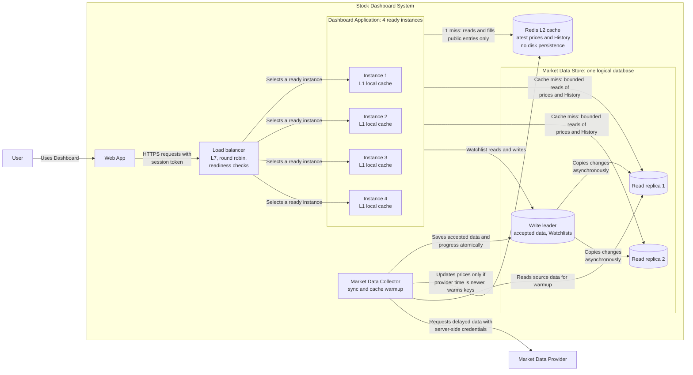
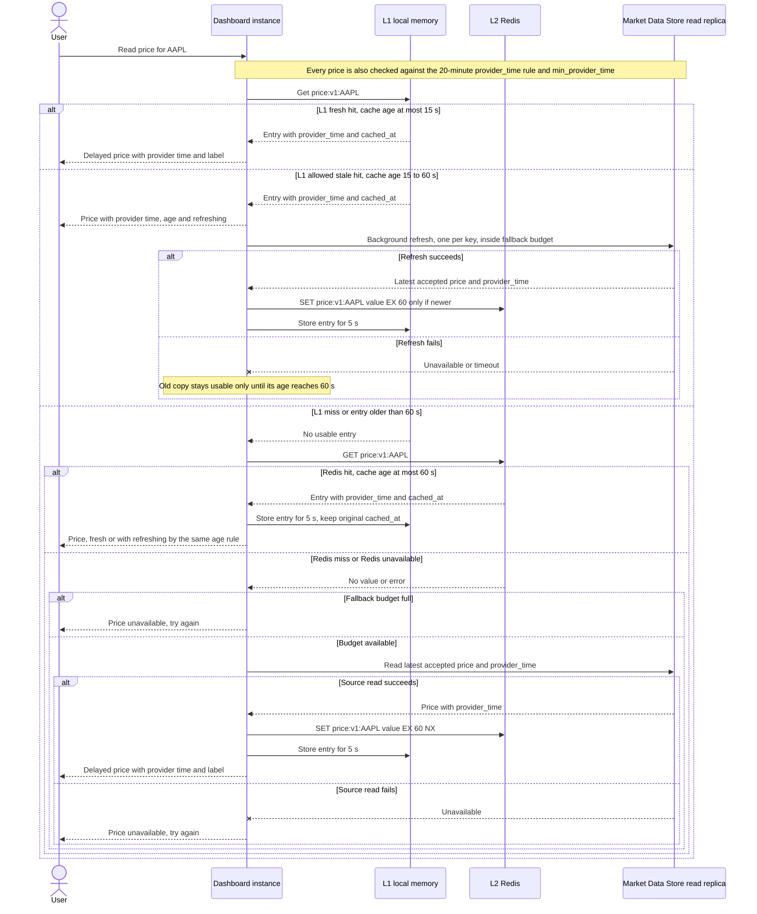
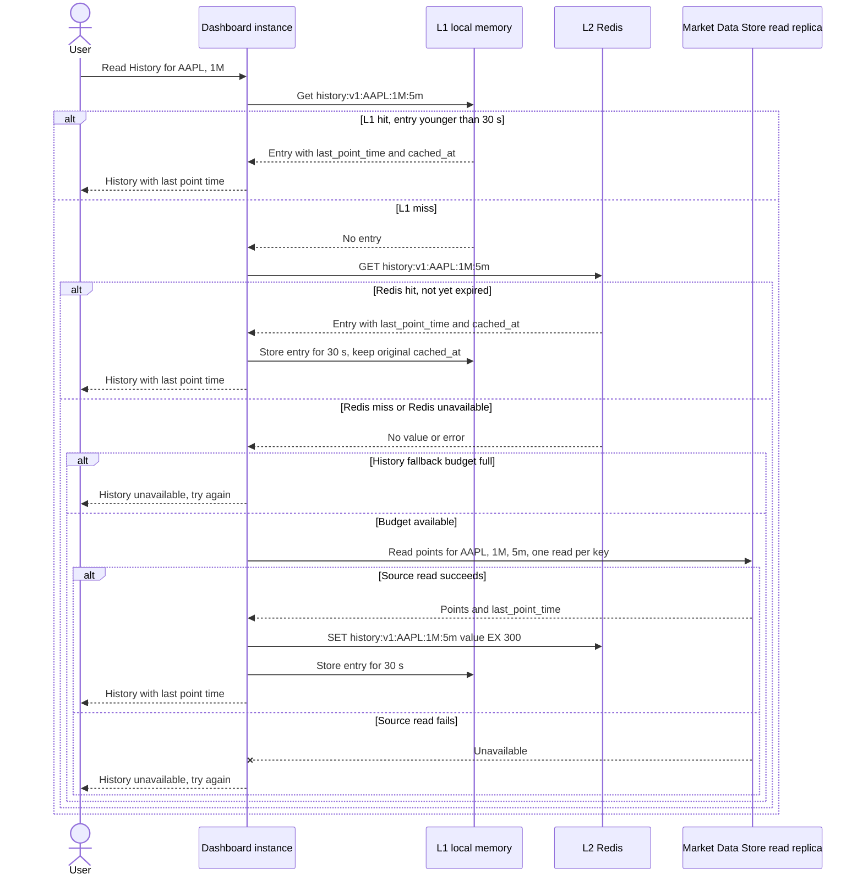

# Lab 4: Scale the Dashboard Read Path

Scope: the 3,000-User case, Stock price reads, and one more public read (History).

## 0. Changes to earlier decisions

| Earlier decision | Change in Lab 4 | Why |
| --- | --- | --- |
| Lab 3: one **Market Data Cache** container (latest prices in memory) | It becomes the shared **Redis L2** cache. Each Dashboard instance also gets a small **L1** local cache. Both hold latest prices and History only. | Lab 4 asks for local memory plus Redis. The rule "update only if provider time is newer" stays. |
| Lab 3: one **Dashboard Database** | It becomes the **Market Data Store**: 1 write leader and 2 asynchronous read replicas. Public reads (price, History, Overview) go to replicas. **Watchlist reads and writes always go to the leader.** | Replicas can lag, and REQ-CON-2 (read-your-writes) forbids a lagging copy for Watchlists. |
| Lab 3: "several identical instances", no balancer | An explicit **L7 load balancer** and **4 Dashboard instances**. | Needed to route to ready instances (section 1). |
| Lab 3: the Collector fills the cache | The Collector also runs the **warmup job** (section 3.4). | It already writes the cache and holds no User state. |
| Lab 3 known gap: monotonic reads with a cache refill | The gap is larger now, because each instance has its own L1 and replicas lag. Mitigation: the Web App sends the newest `provider_time` it has shown for that Stock (`min_provider_time`, public data). An instance ignores any L1, Redis or replica copy older than that. | Keeps REQ-CON-1 monotonic reads across instances. |
| Lab 2 targets (p95, 20-minute rule, 99.9%) | **Unchanged.** | |

Lab 4 sizes only the Stock price path at 3,000 Users (600 RPS). The Lab 2 total at that scale is 1,030 RPS, so the other five reads still need their own sizing and a mixed-load test.

---

## 1. Scale the service and route requests

### 1.1 Instance calculation

```text
buffered Stock price target = 600 RPS x 1.20 = 720 RPS

instances for normal load  = ceil(720 / 250) = 3     (3 x 250 = 750, enough)

3 instances, one stops:  2 x 250 = 500 RPS   too little  (< 720)
4 instances, one stops:  3 x 250 = 750 RPS   enough      (>= 720)

smallest number of ready instances = 4
```

Use the Lecture 5 Deployment and HPA settings, with `replicas: 4`, `minReplicas: 4`, `maxReplicas: 10`, CPU request `500m`, CPU limit `1`, memory request `512Mi`, memory limit `1Gi`, 60% CPU target and a `/ready` readiness probe. The 4-Pod floor comes from the 250 RPS load test, not from the CPU target. That test must be repeated with these resource settings.

### 1.2 Load balancer: L7, round robin

| Part | Choice |
| --- | --- |
| Layer | **L7**. It reads each HTTP request, so one balancer can route price, History and Watchlist paths, drop unready instances per request, and retry a read on another instance. It terminates TLS and forwards the User's session token unchanged. The Dashboard `AuthGuard` still verifies it on every request. |
| Method | **Round robin**. The lab says Stock price requests have similar service cost, so equal turns spread equal work. |
| Why not the others | Hash by client IP would concentrate Users behind one shared IP and gives no benefit here, since no required state lives in an instance. Least connections helps only when request durations differ a lot. |
| Main limit | Equal request counts can still mean unequal work. A History read returns up to about 125 KB, far more than a price read. If the mix shifts toward History, switch to least connections and re-test. Round robin also ignores load, so it depends on the readiness check to stop sending requests to a slow or failing instance. |

```nginx
upstream dashboard_backend {          # round robin is the default
    server dashboard1.internal:8080;
    server dashboard2.internal:8080;
    server dashboard3.internal:8080;
    server dashboard4.internal:8080;
}
```

The balancer must not be a single point of failure. Assumption: it runs as a managed or paired service. Its own availability is outside this lab's calculation.

### 1.3 State and instance loss

| Must survive the loss of one Dashboard instance | Where it lives |
| --- | --- |
| Accepted prices, provider times, history, sync progress | Market Data Store (leader, copied to replicas) |
| Watchlists, per User | Market Data Store leader |
| The User's identity | The session token held by the User. Another instance verifies it on the next request. |

| May stay only in that instance's memory | If the instance stops |
| --- | --- |
| Parsed fields and identity evidence for the current request | The in-flight read fails. The Web App retries it, and another instance serves it. |
| L1 cache entries | Lost. The next request goes to Redis, then the store. |
| In-flight single-flight locks, fallback counters | Lost. They rebuild from new requests. |
| In-memory reference data copy (Lab 3 `StockCatalogService`) | Reloaded from the store when a new instance starts. |

A Watchlist write that was interrupted has an unknown result. The User sees a failure, and the next Watchlist read from the leader shows the true state.

---

## 2. Scale the Market Data Store

### 2.1 Replica calculation

```text
public Stock price reads to serve = 720 RPS    (no cache hit rate assumed)
each read replica                 = 400 RPS
leader                            = 0 RPS for routine public reads

ceil(720 / 400) = 2 read replicas  ->  2 x 400 = 800 RPS  (headroom 80 RPS)
```

With one replica down, 400 RPS is below 720. Section 3.4 sets what the User sees then. A third replica would keep the target after one replica loss (2 x 400 = 800). That costs one more node.

### 2.2 Updated Container View (from Lab 3)



Replicas receive accepted data from the leader asynchronously, so a replica can show an older `provider_time`. The Dashboard judges every price by its `provider_time` (Lab 2 20-minute rule) and by `min_provider_time` (monotonic reads). It never relies on replica freshness.

---

## 3. Cache two public reads

Both reads contain no private User data. Keys and values never include a User ID, session token or Watchlist.

### 3.1 Repeated work removed

| Read | Repeated work without a cache |
| --- | --- |
| **Stock price** | At 3,000 Users, 600 RPS (720 with buffer) over at most 5,172 Stocks. Many Users read the same hot Stock, and the answer only changes about once per 60 s sync. Each miss is one store read. |
| **History** | Each read scans up to 1,638 intraday points or 1,260 daily bars (about 92 to 125 KB) of a Stock that many Users view. The result changes only every 5 minutes (intraday) or once per day (daily). Its RPS is low (2 at 3,000 Users), but each read is the heaviest on the store. I did not choose Overview because the lab text does not say whether it includes User-specific data. |

### 3.2 Cache contracts

| Decision | 1. Stock price | 2. History |
| --- | --- | --- |
| **Key** | `price:v1:{SYMBOL}`, e.g. `price:v1:AAPL`. The symbol is the only input that changes the result. `v1` is the value schema version. | `history:v1:{SYMBOL}:{range}:{interval}`, e.g. `history:v1:AAPL:1M:5m`. Range is `1D`, `1W`, `1M` (interval `5m`) or `6M`, `1Y`, `5Y` (interval `1d`). |
| **Value** | JSON with `symbol`, `price`, `prev_close`, `currency`, `provider_time`, `cached_at`. Labels such as "delayed", "previous close" and "market closed" are **not** stored. They depend on read time and are computed per read. | JSON with `symbol`, `range`, `interval`, `points` (time, price, volume), `last_point_time`, `cached_at`. |
| **Source** | Latest accepted price and its provider time in the Market Data Store (read replica). It can rebuild every key. | Accepted intraday and daily history in the Market Data Store (read replica). |
| **L1 lifetime** | 5 s per entry, at most 5,172 entries (about 1.5 MB). An L1 hit keeps the original `cached_at`, so L1 never extends an entry's age. | 30 s per entry, at most 200 entries per instance, least recently used first (about 25 MB). |
| **Freshness** | **Stale-while-revalidate.** Fresh: `now - cached_at` at most 15 s. Allowed stale: over 15 s and at most 60 s, shown with `refreshing` and its age, with a background refresh. Expiry: Redis `EX 60`. An entry older than 60 s is unusable. A failed refresh does not extend this. The Lab 2 rule also always applies: `provider_time` at most 20 min old in market hours, otherwise the labelled last close or "unavailable". | **Simple TTL.** Fresh until expiry, no stale window. Redis `EX 300` for `1D`, `1W`, `1M`. Redis `EX 900` for `6M`, `1Y`, `5Y` (assumption: a new daily bar may appear up to 15 min late). The response always shows `last_point_time`. |
| **Failure result** | L1 fails: go to Redis. Redis fails or misses: bounded read from a replica. Replica read fails, or the fallback budget is full: "Price unavailable, try again", with no price, never zero and never an expired price. | L1 fails: Redis. Redis fails or misses: bounded replica read. Replica read fails or its budget is full: "History unavailable, try again", with no chart. Prices and Watchlist are unaffected. |

At 5 s of L1 plus Redis fills, a User could see price time T2 from one instance and T1 from another. The `min_provider_time` rule in section 0 stops the older one from being shown after the newer one.

Redis fill rules (production refinement): a miss-fill uses `SET ... EX ... NX`, so it cannot overwrite a newer value that the Collector wrote meanwhile. The Collector's update uses a compare-on-`provider_time` script. If a fill fails, the instance still returns the result it read.

### 3.3 Cache-read sequences

**Stock price** (stale-while-revalidate):



**History** (simple TTL):



### 3.4 Warmup, fallback budget and incomplete warmup

**Fallback budget (protects the replicas).** Replica capacity is 800 RPS. The 3,000-User Overview refresh at open adds about 160 RPS (70 steady + 90 burst) and History about 2 RPS. These are assumed to cost about the same as a price read, which the lab does not state and which needs a load test. So the Stock price fallback budget is **600 RPS store-wide, 150 RPS per instance**, with at most one in-flight read per key per instance. History has a **separate budget of 20 RPS store-wide (5 per instance)**, so heavy History reads cannot starve prices.

**Pre-warm before market open and after recovery.** The Collector runs the job. It starts at 09:15 ET (15 min before open) and again whenever Redis answers `PING` but is empty after an outage. It reads from a replica, not the leader, at a capped rate.

| Cache | Bounded key set | Cap |
| --- | --- | --- |
| Stock price | First the **top 500 Stocks** by yesterday's price reads, then the rest of the **5,172 active Stocks** (about 0.74 MiB of data) | One batch read of the latest-price rows, written to Redis in batches of 500 keys. At most 1 warmup read per 100 ms. |
| History | **Top 50 Stocks** by yesterday's History reads, ranges `1D`, `1M`, `1Y` = **150 keys** | At most 5 reads per second (about 30 s total). |

Before open, a warmed price carries the last close as its `provider_time`. The Lab 2 rule shows it as "market closed" or "previous close" and never as current.

**What the User sees**

| Situation | Stock price | History |
| --- | --- | --- |
| Warmup incomplete, key not yet in Redis | Normal miss path: one bounded replica read, then fill. The price is shown with its provider time. | Same, within the History budget. |
| Fallback budget full (cold caches at peak) | "Price unavailable, try again". No price, never zero, never an expired price. The Web App retries with backoff and stops waiting at 5,000 ms (Lab 2). | "History unavailable, try again", with no chart. |
| Replica read fails | Same unavailable result. The leader is **not** used as a routine fallback. | Same unavailable result. |

With no hit rate assumed, a fully cold start at peak is 720 RPS of misses against a 600 RPS budget. About 120 RPS (17%) would see "unavailable" until caches fill. With one instance down (3 x 150 = 450 RPS budget), about 270 RPS. That is the cost of protecting the replicas. Redis is one instance here, so Redis replication or Sentinel, plus the load and failure tests listed in section 5, are the next steps to reduce it.

---

## 4. Redis cache path with commands

The commands below were run on a local Redis server started with `--save "" --appendonly no`. The `GET` output is shown as `redis-cli` prints it in a terminal, with escaped quotes.

### 4.1 Stock price: `price:v1:AAPL`

```text
$ redis-cli PING
PONG
$ redis-cli CONFIG GET save
1) "save"
2) ""
$ redis-cli CONFIG GET appendonly
1) "appendonly"
2) "no"

$ redis-cli GET price:v1:AAPL
(nil)

# Miss in L1 and Redis. The instance reads the latest accepted price and
# provider_time from a read replica (the durable source in the sequence), then fills:
$ redis-cli SET price:v1:AAPL '{"symbol":"AAPL","price":"227.41","prev_close":"225.80","currency":"USD","provider_time":"2026-11-03T14:46:00Z","cached_at":"2026-11-03T15:01:12Z"}' EX 60
OK
$ redis-cli GET price:v1:AAPL
"{\"symbol\":\"AAPL\",\"price\":\"227.41\",\"prev_close\":\"225.80\",\"currency\":\"USD\",\"provider_time\":\"2026-11-03T14:46:00Z\",\"cached_at\":\"2026-11-03T15:01:12Z\"}"
$ redis-cli TTL price:v1:AAPL
(integer) 58
```

Stored JSON:

```json
{
  "symbol": "AAPL",
  "price": "227.41",
  "prev_close": "225.80",
  "currency": "USD",
  "provider_time": "2026-11-03T14:46:00Z",
  "cached_at": "2026-11-03T15:01:12Z"
}
```

`provider_time` (14:46:00Z, from the provider) and `cached_at` (15:01:12Z, when this copy was made) are different. The price is already 15 min 12 s old by provider time, which matches the expected 15-minute provider delay.

### 4.2 History: `history:v1:AAPL:1M:5m`

```text
$ redis-cli GET history:v1:AAPL:1M:5m
(nil)

# Miss in L1 and Redis. The instance reads the 1M, 5m points from a read replica, then fills:
$ redis-cli SET history:v1:AAPL:1M:5m '{"symbol":"AAPL","range":"1M","interval":"5m","points":[{"t":"2026-11-03T14:30:00Z","p":"226.90","v":182340},{"t":"2026-11-03T14:35:00Z","p":"227.05","v":96110},{"t":"2026-11-03T14:40:00Z","p":"227.20","v":88420}],"last_point_time":"2026-11-03T14:40:00Z","cached_at":"2026-11-03T15:01:15Z"}' EX 300
OK
$ redis-cli GET history:v1:AAPL:1M:5m
"{\"symbol\":\"AAPL\",\"range\":\"1M\",\"interval\":\"5m\",\"points\":[{\"t\":\"2026-11-03T14:30:00Z\",\"p\":\"226.90\",\"v\":182340},{\"t\":\"2026-11-03T14:35:00Z\",\"p\":\"227.05\",\"v\":96110},{\"t\":\"2026-11-03T14:40:00Z\",\"p\":\"227.20\",\"v\":88420}],\"last_point_time\":\"2026-11-03T14:40:00Z\",\"cached_at\":\"2026-11-03T15:01:15Z\"}"
$ redis-cli TTL history:v1:AAPL:1M:5m
(integer) 298
```

Stored JSON (trimmed to 3 of about 1,638 points for the transcript):

```json
{
  "symbol": "AAPL",
  "range": "1M",
  "interval": "5m",
  "points": [
    { "t": "2026-11-03T14:30:00Z", "p": "226.90", "v": 182340 },
    { "t": "2026-11-03T14:35:00Z", "p": "227.05", "v": 96110 },
    { "t": "2026-11-03T14:40:00Z", "p": "227.20", "v": 88420 }
  ],
  "last_point_time": "2026-11-03T14:40:00Z",
  "cached_at": "2026-11-03T15:01:15Z"
}
```

### 4.3 Why a Redis TTL does not prove freshness

`TTL` only says when Redis will drop the key. It counts from the `SET`, not from the provider's data. In 4.1, `TTL` shows 58 s left, but the price's `provider_time` is already 15 minutes old. If the Collector stalled, replicas would keep serving the same old `provider_time`, and each refill would restart the TTL on a price that is 25 or 40 minutes old. The key would look healthy while the data had passed the Lab 2 20-minute limit. So the Dashboard checks `cached_at` against the 15 s and 60 s windows **and** `provider_time` against the 20-minute rule on every read, whichever layer served it. A fast hit proves nothing about how recent the price is.

### 4.4 Persistence choice: none

Redis runs with **no disk persistence** (no RDB, no AOF), as the `CONFIG GET` output above shows. The longest TTL is 900 s, and price entries are unusable after 60 s. A snapshot restored after a restart would hold mostly expired or too-old entries, so persistence buys almost nothing and adds disk writes. Redis also runs with `maxmemory 512mb` and `allkeys-lru` (assumption), so a memory limit evicts old cache keys instead of failing. Current price and History data together would use far less than that.

After a restart, Redis is empty. The same server was restarted to show this:

```text
$ redis-cli DBSIZE
2
$ redis-cli SHUTDOWN NOSAVE        # then start redis-server again with the same config
$ redis-cli DBSIZE
0
$ redis-cli GET price:v1:AAPL
(nil)
$ redis-cli TTL price:v1:AAPL
(integer) -2
```

Behavior after that restart: L1 entries (at most 5 s or 30 s) keep answering for a moment. Then requests follow the miss path, with one read per key and the 600 RPS and 20 RPS fallback budgets. The Collector's warmup job refills the bounded key sets from section 3.4. Users see "unavailable, try again" only when a budget is full.

---

## 5. Load and failure tests to support this design

1. Stock price load test at 720 RPS with the Lecture 5 resource settings. Pass: p95 at most 1,000 ms with 4 ready instances, and still with 1 instance stopped.
2. Replica test: 720 RPS of all-miss price reads, plus the Overview burst. Pass: each replica stays within 400 RPS and its latency target. Then stop 1 replica and record the User result.
3. Cold Redis at market open: measure the fallback budget, the "unavailable" rate and time to a warm cache.
4. Replication lag under a Collector write burst: confirm the 20-minute and `min_provider_time` checks reject old copies.
5. Mixed workload at 1,030 RPS to check that the other five reads fit.

---

## Checklist

- [x] My Dashboard instance calculation includes the buffer and one-instance loss (720 RPS, 4 instances).
- [x] I chose a load-balancing layer and method (L7, round robin), and explained the reason and a limit.
- [x] My updated Container View shows the load balancer, service instances, and database instances. Required state survives a service instance loss.
- [x] I have two cache use cases (Stock price, History), each with one contract and one sequence diagram showing L1, Redis, and the durable source.
- [x] My cache keys and values contain no private User data.
- [x] My sequences show cache hits, misses, source failure, and stale-while-revalidate (allowed stale result and failed background refresh) for Stock price.
- [x] My warmup is bounded, and incomplete warmup or full fallback capacity has an explicit User-visible result.
- [x] Each Redis transcript shows `GET` miss, `SET ... EX`, `GET` hit, and `TTL`, with a JSON value and a persistence choice.
- [x] I explain why Redis TTL does not prove source-data freshness.
- [x] My Mermaid diagrams render without an error (all 3 blocks parsed with Mermaid 11).